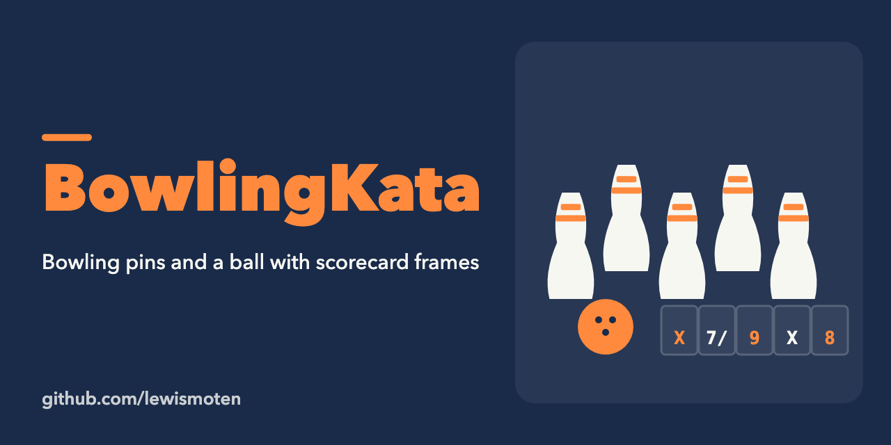

# BowlingKata

The bowling game kata in C# (2013). `BowlingCada` holds the game and frame scoring; `BowlingCada_UnitTest` holds its unit tests.

Open `BowlingCada.sln` in Visual Studio (a 2013-era solution using the MSTest framework) and run the tests. Not maintained.
